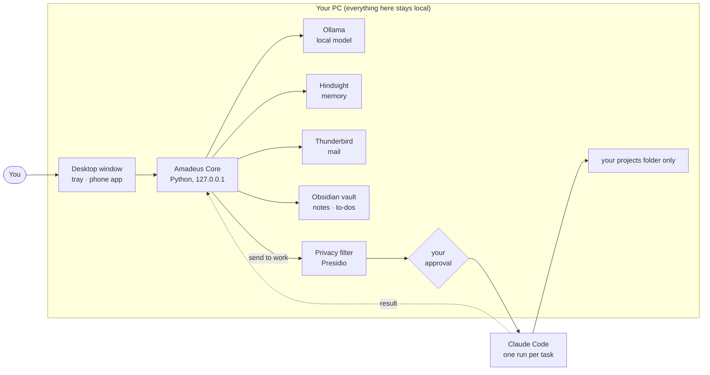

# Amadeus

[](https://github.com/IAbrahamI/Amadeus/actions/workflows/tests.yml)


**Your own private AI assistant, running on your own PC.** Amadeus runs on a local model, knows your calendar, mail,
notes and to-dos, remembers what matters about you, and calls you when something needs you (the small window rings,
or your phone). It never changes anything without your OK, and your private life stays on your machine. Bigger work
(code, documents, research) it hands to Claude Code, but only through a privacy filter and only after you approved
the exact text that leaves.

> **Status:** a personal project, built for and tested on one Linux PC (CachyOS, KDE Plasma, NVIDIA 12 GB) by one
> user. It works every day there; on other setups expect rough edges. Issues are welcome, pull requests aren't expected.

You decide who your assistant is: its name, its personality, and whether it has a face and a voice.


<sub>The dashboard with demo data: the core in the middle is the assistant, drawn from its memory. More:
[approvals with Adjust](docs/images/dashboard-approvals.png), [the Purple theme](docs/images/dashboard-purple.png).</sub>

## What it does

- **Chat, one conversation per day.** A small always-on-top window for quick questions, a full dashboard for
  everything else, with the assistant as a living core of its memories in the middle. Type or talk (a wake word
  with its name, local speech recognition).
- **Calendar, reminders, to-dos.** It plans your day, adds and moves appointments, and calls you before they start.
- **Mail through Thunderbird.** Overviews, verification codes, drafts in your style, filing. Only urgent mail
  calls you; the rest goes into a short evening summary.
- **Memory.** A long-term memory (Hindsight) and a profile of how you work and communicate, which it adapts to.
- **Work runs.** "Send this to work": the text is anonymised, you approve exactly what leaves, and one
  Claude Code run works on it in a project folder of your Obsidian vault. The result comes back into the chat.
- **Phone.** An Android app reaches it over your private Tailscale network, rings for its calls and syncs with the PC.
- **Approvals for everything.** Every action that changes something becomes a card you approve, reject, or adjust
  ("make it 16:00 instead", and it redrafts the same action for your OK).
- **Learns from you.** Rate answers with 👍 / 👎. Every night it turns its mistakes into short lessons, and keeps a
  lesson only if a test on your own past requests doesn't get worse. No retraining, nothing leaves the PC.
- **Skills in an open format.** Skills use the [agentskills.io](https://agentskills.io) format, so skills from public
  libraries can be dropped in.
- **Add your own.** A ＋ on the Skills, Playbooks and Connectors pages: write a skill or a recipe in your own words,
  or plug in any [MCP](https://modelcontextprotocol.io) server as a connector (its tools always ask you first).

## Make it yours

| What | How |
|---|---|
| **Name** | `"assistant_name": "Nova"` in `~/.config/amadeus-core/config.json`. It's used everywhere, including the wake word. |
| **Personality** | Write a short persona in `~/.local/share/amadeus/core/personas/<name>.md` and set `"persona": "<name>"`. The default is friendly and to the point. |
| **Look** | Three main colours (Default blue, Purple, Red) at the top of Settings. |
| **Face** | For calls and the phone: the default is a small chibi agent. Add your own animated sprites (moods, lip-sync, eyes that follow the mouse) and set `"avatar": "<set>"`. |
| **Voice** | Add your own short clips (greetings, a ringtone, reactions to words) with a small `voice-pack.json`. Without them it stays silent and rings with a soft tone. |

All of this can be set under **Settings → Assistant** (name, personality, your own avatar images, or "Use the
defaults") and **Settings → Voice**; details in [docs/INSTALL.md](docs/INSTALL.md#make-it-yours). Everything you add
stays on your PC and out of git.

## How it fits together



Everything listens on `127.0.0.1` only. The single way out is a work run, and it only gets the filtered text
you approved. More detail, including the privacy filter step by step: [docs/ARCHITECTURE.md](docs/ARCHITECTURE.md).

## Getting started

You need Linux with systemd (KDE Plasma gives the best experience, other desktops work too), Python 3.10 or newer,
Docker, Ollama, GTK 3 with WebKit2GTK 4.1 and PyQt6 for the window and tray, GStreamer for sound, about 15 GB of
disk (mostly the local model and the memory and privacy-filter images), and ideally an NVIDIA GPU with about 12 GB.
The exact packages for Arch, Debian/Ubuntu and Fedora are in [docs/INSTALL.md](docs/INSTALL.md#1-what-you-need).

```bash
git clone https://github.com/IAbrahamI/Amadeus.git && cd Amadeus
./install.sh --check        # what's there and what's missing (changes nothing)
./install.sh                # asks for your vault, a projects folder, mail and voice, then sets everything up
amadeus                     # open it; later, amadeus update gets the newest version
```

The full guide, including the phone app and work runs, is in [docs/INSTALL.md](docs/INSTALL.md).
Everything your assistant knows is stored in `~/.local/share/amadeus/` on your PC and never in this repository.

## Built with

Python (the core uses only the standard library) · plain JavaScript and WebGL, no build step · GTK/WebKit and PyQt
for the desktop window and tray · Kotlin + Jetpack Compose for the phone app · [Ollama](https://ollama.com) (Qwen 3.5) ·
[Hindsight](https://github.com/vectorize-io/hindsight) · [Presidio](https://github.com/microsoft/presidio) ·
[Whisper](https://github.com/SYSTRAN/faster-whisper) and [Vosk](https://alphacephei.com/vosk/) ·
[Piper](https://github.com/OHF-Voice/piper1-gpl) and [Kokoro](https://github.com/hexgrad/kokoro) for reading aloud ·
[MCP](https://modelcontextprotocol.io) for your own connectors · [Claude Code](https://claude.com/claude-code) ·
[Tailscale](https://tailscale.com)

## Why it's built this way

I wanted one place for my day instead of a handful of chat apps from different providers, and a hard wall between
my private life and cloud models. That led to a few decisions:

- **A local model with approvals, not a cloud agent.** The model can be wrong, so it never acts on its own: anything
  that changes or sends something waits for you. That makes a 9B local model good enough for daily use.
- **Anonymise, don't pseudonymise.** Text for Claude Code gets fixed labels like `[PERSON]`, never a mapping that
  could be reversed, and you see the exact text before it leaves. The filter is best effort; your approval is the gate.
- **Guarded work runs.** Each Claude Code run is one task in one project folder, in a projects folder you choose
  outside your vault. A hook and Claude Code's sandbox keep it from writing anywhere else or reading your notes.
- **It learns without retraining.** Your 👍 / 👎 become short lessons overnight, and a lesson is kept only if a test
  on your own past requests doesn't get worse.

More, including the limits of the privacy filter: [docs/ARCHITECTURE.md](docs/ARCHITECTURE.md#limits).

## Repository

| Path | What |
|---|---|
| `core/` | The assistant: server, web UI, desktop window and tray, voice, Thunderbird bridge, privacy filter, skills, personas |
| `android/` | The phone app |
| `obsidian/` | The hourly vault snapshots and the README for Amadeus's folder in your vault |
| `install.sh` | Sets up the local services |
| `docs/` | [Install guide](docs/INSTALL.md), [architecture](docs/ARCHITECTURE.md), [features and settings](docs/FEATURES.md) |

## Security

Found a way private data could leave the PC, or another security problem? Please report it privately through
[GitHub's security advisories](https://github.com/IAbrahamI/Amadeus/security/advisories/new) instead of an issue.
See [SECURITY.md](SECURITY.md).

## License

Source-available and free for personal, non-commercial use; no credit needed. It isn't an OSI open-source license,
so GitHub shows it as "Other". See [LICENSE](LICENSE).
