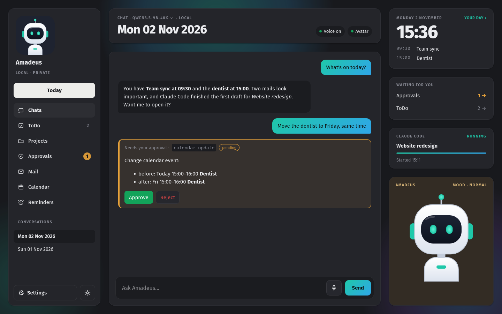
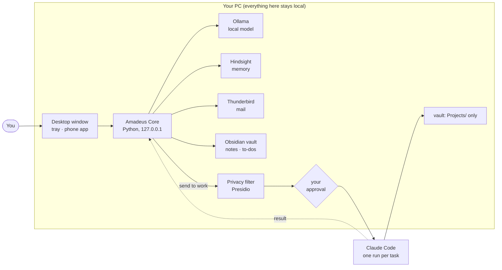

# Amadeus

**Your own private AI assistant, running on your own PC.** Amadeus runs on a local model, knows your calendar, mail,
notes and to-dos, remembers what matters about you, and calls you when something needs you. It never changes
anything without your OK, and nothing private leaves your machine. Bigger work (code, documents, research) it
hands to Claude Code, but only through a privacy filter and only after you approved the exact text.

You decide who your assistant is: its name, its personality, and whether it has a face and a voice.



<sub>The dashboard with demo data and the default avatar, in dark mode. There is also a [light mode](docs/images/dashboard-light.png).</sub>

## What it does

- **Chat, one conversation per day.** A small always-on-top window for quick questions, a full dashboard for
  everything else. Type or talk (a wake word with its name, local speech recognition).
- **Calendar, reminders, to-dos.** It plans your day, adds and moves appointments, and calls you before they start.
- **Mail through Thunderbird.** Overviews, verification codes, drafts in your style, filing. Only urgent mail
  calls you; the rest goes into a short evening summary.
- **Memory.** A long-term memory (Hindsight) and a profile of how you work and communicate, which it adapts to.
- **Work runs.** "Send this to work": the text is anonymised, you approve exactly what leaves, and one
  Claude Code run works on it in a project folder of your Obsidian vault. The result comes back into the chat.
- **Phone.** An Android app reaches it over your private Tailscale network, rings for its calls and syncs with the PC.
- **Approvals for everything.** Every action that changes something becomes a card you approve or reject.
- **Learns from you.** Rate answers with 👍 / 👎. Every night it turns its mistakes into short lessons, and keeps a
  lesson only if a test on your own past requests doesn't get worse. No retraining, nothing leaves the PC.
- **Skills in an open format.** Skills use the [agentskills.io](https://agentskills.io) format, so skills from public
  libraries can be dropped in.

## Make it yours

| What | How |
|---|---|
| **Name** | `"assistant_name": "Nova"` in `~/.config/amadeus-core/config.json`. It's used everywhere, including the wake word. |
| **Personality** | Write a short persona in `~/.local/share/amadeus/core/personas/<name>.md` and set `"persona": "<name>"`. The default is friendly and to the point. |
| **Face** | The default is a small chibi agent. Add your own animated sprites (moods, lip-sync, eyes that follow the mouse) and set `"avatar": "<set>"`. |
| **Voice** | Add your own short clips (greetings, a ringtone, reactions to words) with a small `voice-pack.json`. Without them it stays silent and rings with a soft tone. |

Details are in [docs/INSTALL.md](docs/INSTALL.md#make-it-yours). Everything you add stays on your PC and out of git.

## How it fits together



Everything listens on `127.0.0.1` only. The single way out is a work run, and it only gets the filtered text
you approved. More detail, including the privacy filter step by step: [docs/ARCHITECTURE.md](docs/ARCHITECTURE.md).

## Getting started

You need Linux with systemd (KDE Plasma gives the best experience, other desktops work too), Docker, Ollama and
ideally an NVIDIA GPU with about 12 GB of memory.

```bash
git clone https://github.com/IAbrahamI/Amadeus.git && cd Amadeus
./install.sh --check        # what's there and what's missing (changes nothing)
./install.sh                # local model, keys, privacy filter, memory, Obsidian folder
core/deploy/install.sh      # the assistant itself: services, window, tray
amadeus                     # open it
```

The full guide, including mail, voice, the phone app and work runs, is in [docs/INSTALL.md](docs/INSTALL.md).
Everything your assistant knows is stored in `~/.local/share/amadeus/` on your PC and never in this repository.

## Built with

Python (standard library) · plain JavaScript · GTK/WebKit and PyQt for the desktop window and tray ·
Kotlin + Jetpack Compose for the phone app · [Ollama](https://ollama.com) (Qwen 3.5) ·
[Hindsight](https://github.com/vectorize-io/hindsight) · [Presidio](https://github.com/microsoft/presidio) ·
[Whisper](https://github.com/SYSTRAN/faster-whisper) and [Vosk](https://alphacephei.com/vosk/) ·
[Claude Code](https://claude.com/claude-code) · [Tailscale](https://tailscale.com)

## Repository

| Path | What |
|---|---|
| `core/` | The assistant: server, web UI, desktop window and tray, voice, Thunderbird bridge, privacy filter, skills, personas |
| `android/` | The phone app |
| `obsidian/` | The guard that keeps work runs inside the vault's `Projects/` folder, and hourly vault snapshots |
| `install.sh` | Sets up the local services |
| `docs/` | [Install guide](docs/INSTALL.md), [architecture](docs/ARCHITECTURE.md), [features and settings](docs/FEATURES.md) |

## License

Free for personal, non-commercial use; no credit needed. See [LICENSE](LICENSE).
