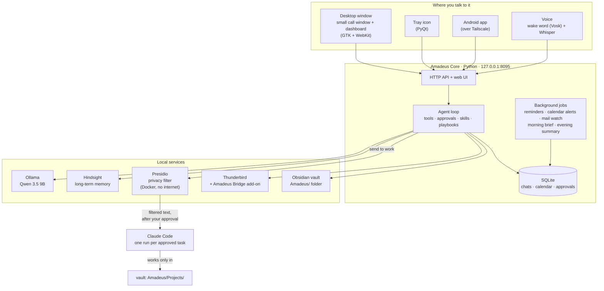
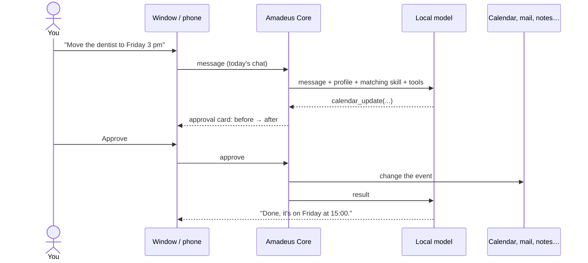
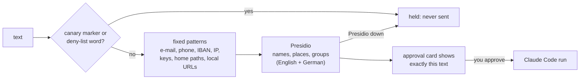

# Architecture

Amadeus has two sides with one narrow door between them:

- **The private side** runs entirely on your PC: the assistant, a local model, its memory, your mail, calendar,
  notes and to-dos. It works offline, and nothing on it ever goes to a cloud model.
- **The work side** is Claude Code, for things a local model can't do well (code, documents, research).
  It only ever receives text that went through the privacy filter *and* that you approved word for word.

## Components

| Part | Where | Notes |
|---|---|---|
| Amadeus Core | `core/amadeus_core/` | `server` (API + static files), `agent` (model loop, approvals), `tools` (everything it can do), `privacy` (the filter), `work` (Claude Code runs), `background` (timed jobs), `quickchat` (one chat per day), `digest` (morning brief, evening summary) |
| Web UI | `core/web/` | Plain HTML/CSS/JS, no build step: dashboard (`index.html`), the small call window (`call.html`), the default avatar (`agent.svg`) |
| Desktop | `core/desktop/` | `popup.py` (the window), `tray.py` (tray icon) |
| Voice | `core/voice/` | `voice_server.py` (Whisper speech recognition), `wake.py` (wake word) |
| Mail | `core/thunderbird/` | A Thunderbird add-on plus a native-messaging host; Thunderbird keeps your accounts and logins |
| Phone | `android/` | Kotlin + Compose; pairs with a one-time code and talks to Core over Tailscale |
| Memory extension | `core/hindsight_ext/` | Makes every Hindsight request need your local key |
| Work guard | `obsidian/` | Hook, deny rules and sandbox settings that keep Claude Code inside `Projects/` |

## A request, end to end

Reading things (calendar, mail, memory) runs straight away. Anything that changes or sends something waits for
your click: on the card in the chat, on the Approvals page, in a call on the PC, or on the phone.

## The privacy filter

Everything that would leave the PC (a work run, a follow-up to one, a message to Claude Code from a project page)
goes through `core/amadeus_core/privacy.py`:

- Replacements are fixed labels such as `[PERSON]`, `[EMAIL]` or `[LOCATION]`. It's anonymisation, not
  pseudonymisation: two different people both become `[PERSON]`, and nothing is mapped back.
- Company and brand names are kept on purpose, so a task about GitHub or a framework still makes sense.
  Words you add to the allow-list are never replaced.
- Canary markers are random strings created at install time. A nightly leak scan checks that none of them
  ever shows up in a work run's conversation or in the `Projects/` folder.
- If Presidio isn't reachable, the text is held, never sent unchecked.

## The work side

A work run is one `claude -p` call in the vault's `Amadeus/Projects/<Name>/` folder, on your own Claude
subscription. The guard installed by `install.sh` (a pre-tool hook, deny rules and Claude Code's sandbox)
lets it read and write only that `Projects/` folder: not the rest of your vault, not Amadeus's data, not your
keys. If a run ends with questions, your answers continue the same session. The project page has an
**Open in Claude Code** button that opens the session in a terminal.

## Where data lives

| What | Where | In git? |
|---|---|---|
| Chats, calendar, approvals, settings | `~/.local/share/amadeus/core/amadeus.db` | never |
| Memory | Docker volume `hindsight-data` | never |
| Keys, canary markers, deny-list | `~/.local/share/amadeus/secrets/` (mode 700) | never |
| Your settings | `~/.config/amadeus-core/config.json` | never |
| Notes, to-dos, work projects | your Obsidian vault, `Amadeus/` folder | never |
| Your persona, avatar sprites, voice clips | `~/.local/share/amadeus/core/personas/`, `…/core/avatar/`, `~/.local/share/amadeus/voice/clips/` | never |

## Network

| Port | Service | Reachable from |
|---|---|---|
| 8095 | Amadeus Core | this PC, and your paired phone through `tailscale serve` (tailnet only) |
| 8896 | Voice service | this PC |
| 11434 | Ollama | this PC |
| 8888 / 9999 | Hindsight API / UI | this PC |
| 172.30.77.10-11 | Presidio | this PC only (an internal Docker network without internet) |
